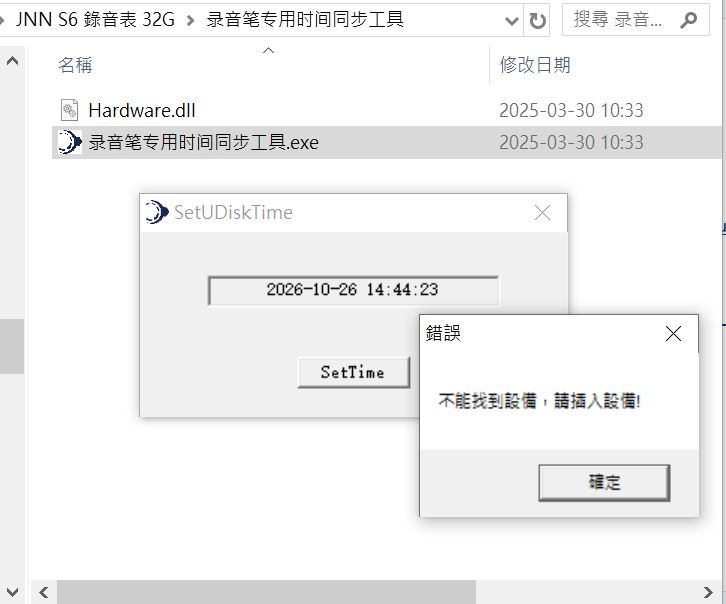
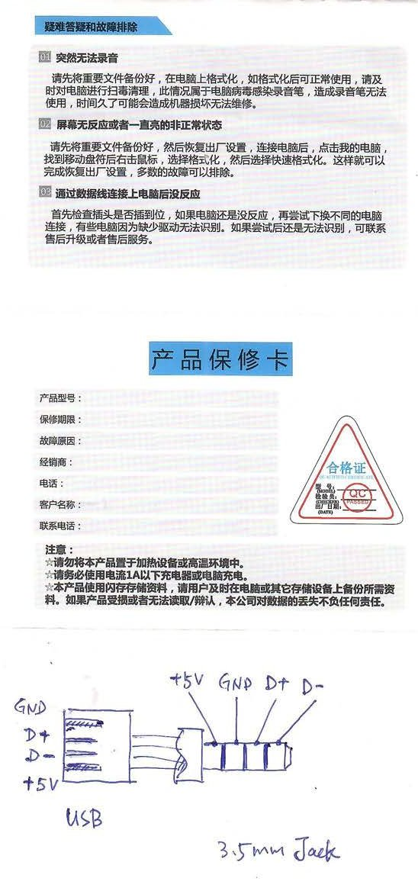
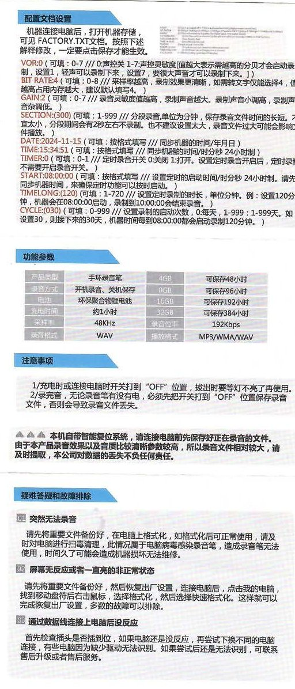
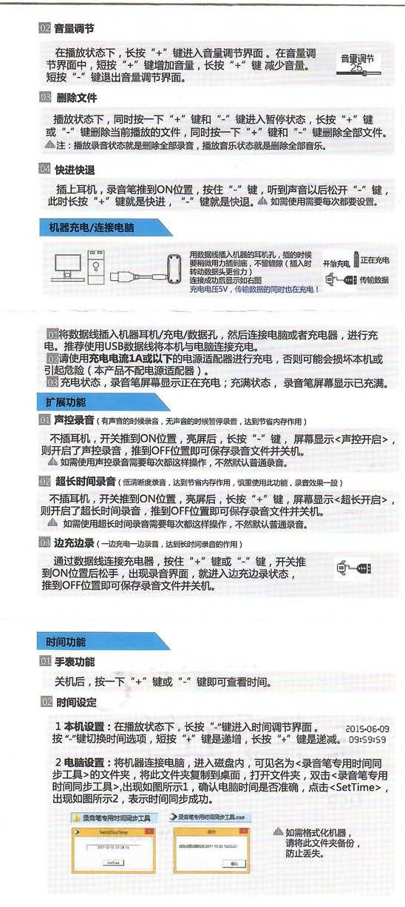
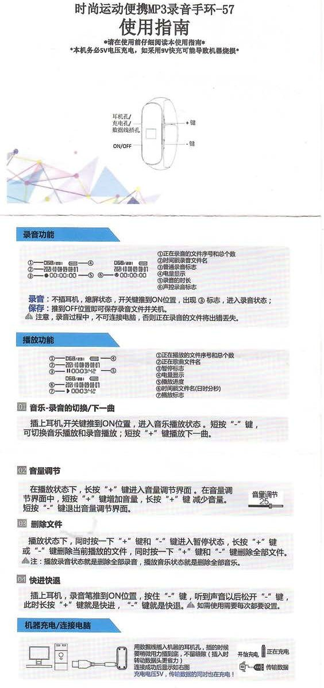

# JNN S6 錄音表 32G
S6 錄音表  

https://jnnrec.com/  

user manual  
[JNN_S6_錄音表_32G_user_manual.pdf](JNN_S6_錄音表_32G_user_manual.pdf)  
[JNN_S6_錄音表_32G_user_manual_binder.pdf](JNN_S6_錄音表_32G_user_manual_binder.pdf)  

time sync tools  
[JNN录音参数工具_55两档-定录_221216.exe](JNN录音参数工具_55两档-定录_221216.exe)  

it is not working, win10  
[录音笔专用时间同步工具](录音笔专用时间同步工具)  
  

manual jpg, usb conection,
    
    
    
    
